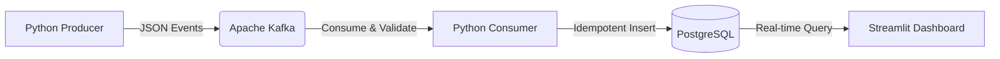

# Real-Time Financial Data Analytics Pipeline

## 📖 What is the Project About?
An end-to-end streaming data pipeline that ingests, processes, and visualizes synthetic financial transactions in real-time. It mimics the architecture of modern fintech backends, utilizing a pub/sub event bus (Apache Kafka) and a persistent relational store (PostgreSQL) for live analytics.

## 🎯 Importance of the Project
In modern financial systems, batch processing is no longer sufficient. Detecting anomalies, tracking liquidity, and updating user balances must happen with sub-second latency. This project demonstrates how to orchestrate a distributed streaming architecture to achieve real-time observability and resilient data ingestion.

## 👥 Who is this for?
- **Data Engineers:** To understand the integration patterns between Kafka and relational databases.
- **FinTech Operations Teams:** Needing real-time dashboards of transaction throughput and system health.
- **Software Architects:** Designing scalable, event-driven microservices.

## 🏗️ Architecture


## 💻 Tech Stack
- **Streaming Engine:** Apache Kafka, Zookeeper
- **Database:** PostgreSQL
- **Data Processing:** Python, `confluent-kafka` (or `kafka-python`), Pandas
- **Frontend UI:** Streamlit
- **Infrastructure:** Docker, Docker Compose

## 🚀 Steps to Clone & Setup

1. **Clone the repository:**
   ```bash
   git clone https://github.com/vamshidharsingh/financial-streaming-analytics.git
   cd financial-streaming-analytics
   ```
2. **Start the Infrastructure (Kafka & DB):**
   ```bash
   docker-compose up -d
   ```
3. **Setup Python Environment:**
   ```bash
   python -m venv venv
   
   # On macOS/Linux:
   source venv/bin/activate  
   
   # On Windows:
   .\venv\Scripts\activate
   
   pip install -r requirements.txt
   ```

## 🕹️ How to Use It
1. **Start the Producer:** Run the producer to begin broadcasting synthetic financial events into Kafka.
   ```bash
   python producer.py
   ```
2. **Start the Consumer:** In a new terminal, run the consumer to ingest the stream and safely write to Postgres.
   ```bash
   python consumer.py
   ```
3. **Launch the Dashboard:** In a third terminal, start the analytics UI to visualize the live data.
   ```bash
   streamlit run dashboard.py --server.port 8503
   ```
4. **View Real-Time Data:** Open `http://localhost:8503` to view the incoming volume metrics and graphs updating live!

## 🔮 Possible Improvements / Future Enhancements
- **Apache Spark / Flink:** Introducing a dedicated stream processing engine for complex windowed aggregations.
- **Schema Registry:** Implementing Avro and Confluent Schema Registry to enforce strict data contracts.
- **Alerting System:** Adding a module to send Slack/Email alerts when transaction volumes drop below a certain threshold or if anomalies are detected.

## 📄 License
This project is licensed under the MIT License.
